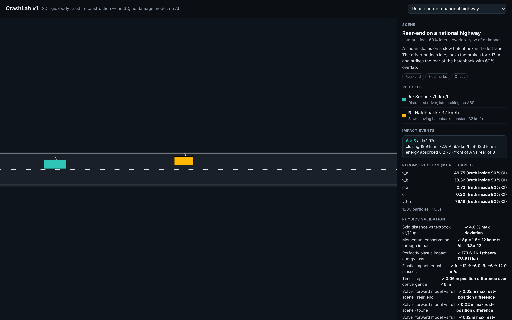
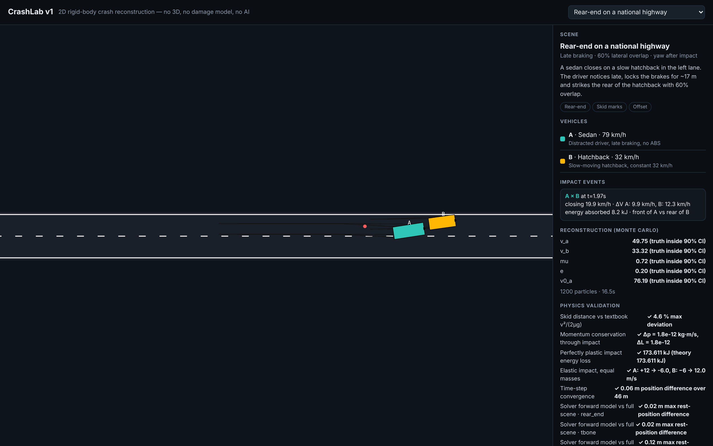

# CrashLab v1 — 2D crash reconstruction engine

A free, open-source physics engine for reconstructing road-traffic collisions, built from
scratch in Python/NumPy. This is the foundation release: planar rigid-body vehicle dynamics,
a tyre/skid model, rectangle-on-rectangle collision with momentum-conserving impact, and a
sequential Monte-Carlo solver that works *backwards* from the police-report-style evidence
(rest positions, skid marks, damage zone) to recover the speeds nobody measured.

No 3D, no AI, no damage model — those arrive in [v2](https://github.com/rochitl72/crash-sim-v2)
and [v3](https://github.com/rochitl72/crash-sim-v3). This repo is deliberately the simplest,
most auditable version of the idea: if you want to understand or verify the physics, start here.

> Built for Indian road-safety / traffic-officer reconstruction work — left-hand traffic,
> Indian vehicle classes (sedan, hatchback, SUV, truck, motorcycle), National-Highway-style
> scenes (fog pile-up, signalised-junction crash, two-wheeler conflict, etc).

## Screenshots

**Scene before impact** — top-down 2D replay, scene picker, vehicle list, story panel:


**After impact** — skid marks drawn live, impact marker, closing speed / ΔV / energy readout,
Monte-Carlo reconstruction posterior, and the physics self-test suite:


## Why this exists

A traffic officer at a crash scene has: rest positions, skid marks, crush/contact point, maybe
a witness statement. They almost never have the impact speeds — those are exactly what a
reconstruction has to produce. Commercial tools like PC-Crash do this, but they are expensive,
Windows-only, and closed-source, which is a real barrier for government and police use in India.
CrashLab is an attempt at an open, inspectable alternative, starting with the physics core.

## What's inside, technically

### 1. Vehicle model (`crashlab/vehicles.py`)
Each vehicle is a `Spec`: mass, yaw inertia `izz`, length/width, CG-to-axle distances `a`/`b`,
CG height `h`, and a wheel table `[x, y, steer?, drive_frac, brake_frac, static_load_frac]` per
wheel. Five classes ship out of the box — sedan, hatchback, SUV, goods truck, motorcycle —
with typical-class mass/dimension/stiffness numbers (not measured data for a specific model;
swap in real figures for an actual case).

### 2. Tyre & vehicle dynamics (`crashlab/dynamics.py`)
Planar 3-DOF rigid body (`vx, vy, r` — forward speed, lateral speed, yaw rate), stepped at
`dt=2ms`. Per wheel: normal load with longitudinal/lateral load transfer, a friction-ellipse
tyre force (`Fy = -μ·Fz·tanh(c_α·α/μ)` for a rolling wheel, Coulomb sliding once locked),
rolling resistance and aerodynamic drag. ABS is modelled as a slip cap (`0.92·μ` instead of full
lock) rather than a real wheel-speed controller — good enough to reproduce "ABS leaves no skid
marks" without simulating the hydraulics.

### 3. Collision & impact (`crashlab/collision.py`)
Separating-Axis Theorem (SAT) on the two vehicles' oriented rectangles gives the contact normal,
penetration depth and contact point. The impact itself uses classical impulse-momentum collision
theory — the same math taught in every reconstruction textbook: conserve linear + angular
momentum through the contact, apply a restitution coefficient `e` along the normal and Coulomb
friction `μ_c` along the tangent. This is **not** a finite-element crash model; it's the
lumped-parameter approach every reconstruction program (PC-Crash included) actually uses for
speed/ΔV estimation.

### 4. The simulator loop (`crashlab/engine.py`)
Drives N vehicles through: driver model (`drivers.py` — pure-pursuit steering toward a path,
scripted or reactive braking) → tyre dynamics → collision check every step → event/mark logging.
Stops automatically once every vehicle is at rest. Produces per-vehicle trajectories, skid-mark
polylines, and a structured impact-event record (closing speed, ΔV, energy absorbed, impact
angle and zone) for every collision.

### 5. Reconstruction — the actual hard part (`crashlab/inverse.py`)
This is the direction a real investigation needs: given the simulated/observed outcome (rest
positions, final headings), infer the unknowns (impact speeds, friction, restitution) that
produced it. Implemented as **Sequential Monte Carlo (particle filtering with likelihood
tempering)** — start with ~1000–1200 particles at a wide prior, run each one forward through a
closed-form post-impact model, re-weight by how close it lands to the observed rest state,
resample, and repeat with a tempered likelihood schedule until it concentrates. Returns a
posterior distribution per unknown (`reconstruct()` → median + 90% credible interval), not a
single "answer" — exactly the honest way to communicate "the impact speed was 48–55 km/h with
90% confidence" instead of a false-precision single number.

### 6. Validation (`tests/test_physics.py`, run on every build)
Five independent sanity checks ship with the repo and run automatically in `build.py`:
skid distance vs. the textbook `v²/(2μg)` formula, momentum conservation through an oblique
impact (machine precision), perfectly-plastic impact energy loss vs. the closed-form `e=0`
answer, an `e=1` elastic collision (velocities should swap for equal masses), and solver
time-step convergence (4 ms vs 1 ms). Every scene also re-checks that the Monte-Carlo
reconstruction's forward model agrees with the full multi-vehicle simulation to <0.3 m.

### 7. Viewer (`viewer/template.html`)
A single self-contained HTML file (`build.py` inlines the simulated data directly into it — no
server, no dependencies, works offline from a `file://` URL). Plain `<canvas>` 2D top-down
renderer: scene picker, play/scrub/speed controls, live-drawn skid marks, impact markers, the
vehicle/event/reconstruction/validation panels on the right.

## Project layout

```
crashlab/
  vehicles.py    vehicle catalogue (Spec class + 5 classes)
  dynamics.py    tyre model + rigid-body integration step
  collision.py   SAT contact detection + impulse-momentum impact
  drivers.py     steering (pure pursuit) / acceleration (scripted, reactive) driver models
  engine.py      the scene simulator loop (Scene, VehicleCfg, run_scene)
  scenes.py      6 pre-built Indian road-traffic scenes
  inverse.py     Sequential Monte Carlo reconstruction solver
viewer/
  template.html  single-file 2D canvas viewer (data gets inlined at build time)
tests/
  test_physics.py  5 textbook-derived physics sanity checks
examples/
  custom_scene.py  minimal script: build → simulate → reconstruct, outside the 6 presets
build.py         runs all 6 scenes + reconstruction + validation, writes dist/crashlab.html
```

## Clone and run

Requires Python 3.9+ and NumPy. No API keys, no network access, no external services —
everything runs locally.

```bash
git clone https://github.com/rochitl72/crash-sim-v1.git
cd crash-sim-v1
pip install -r requirements.txt     # just numpy (+ optional playwright for dev screenshots)

python3 build.py                    # runs the 6 scenes + reconstruction + validation (~70s)
                                     # writes dist/data.json and dist/crashlab.html
```

Then just open `dist/crashlab.html` directly in a browser — it's one file, no server needed:

```bash
# macOS
open dist/crashlab.html
# Linux
xdg-open dist/crashlab.html
# or serve it if you prefer:
python3 -m http.server 8080 --directory dist   # -> http://127.0.0.1:8080/crashlab.html
```

### Running the validation suite on its own

```bash
python3 -m pytest tests/ -q         # or: python3 -c "from tests import test_physics as T; print(T.t_momentum())"
```

### Writing your own scene

```python
from crashlab import vehicles as V
from crashlab.drivers import accel_script, pursuit
from crashlab.engine import Scene, VehicleCfg, run_scene
from crashlab.scenes import road_straight
from crashlab.inverse import reconstruct

car, suv = V.sedan(), V.suv()
a = VehicleCfg("A", car, x=0, y=0, psi=0, speed=20.0,
               steer_fn=pursuit([(0, 0), (300, 0)], car.wheelbase),
               accel_fn=accel_script([(0, "hold", 20.0), (2.8, "brake", 1.5)]))
b = VehicleCfg("B", suv, x=45, y=0, psi=0, speed=8.0,
               steer_fn=pursuit([(0, 0), (300, 0)], suv.wheelbase),
               accel_fn=accel_script([(0, "hold", 8.0)]))
scene = Scene("demo", "Demo rear-end", "", "", [a, b], road_straight(-20, 200, -3.5, 3.5), mu=0.75, t_end=10)

res = run_scene(scene)
for e in res["events"]:
    print(f"impact at t={e['t']:.2f}s  closing {e['closing_kmh']} km/h")
out, model, th = reconstruct(res)
print(out["summary"])
```

Or just run the shipped example:

```bash
python3 -m examples.custom_scene
```

## Known limitations (fixed in later versions)

- No 3D visualisation — top-down 2D only. → fixed in [v2](https://github.com/rochitl72/crash-sim-v2).
- No crush/damage model, no CDC codes, no airbag/seatbelt/occupant-injury modelling. → v2.
- No roll/tip-over physics for two/three-wheelers (they slide but don't model the fall
  dynamics or lane-departure rollover of a car). → v2.
- Only 5 vehicle classes, hand-typed "typical class" numbers rather than per-make/model specs.
- No way to take a real police report / PC-Crash export as input — scenes are hand-authored
  Python. → fixed in [v3](https://github.com/rochitl72/crash-sim-v3), which adds an AI-assisted
  pipeline that reads a PC-Crash values export + officer notes and builds the scene automatically.

## License

MIT — see [LICENSE](LICENSE).
